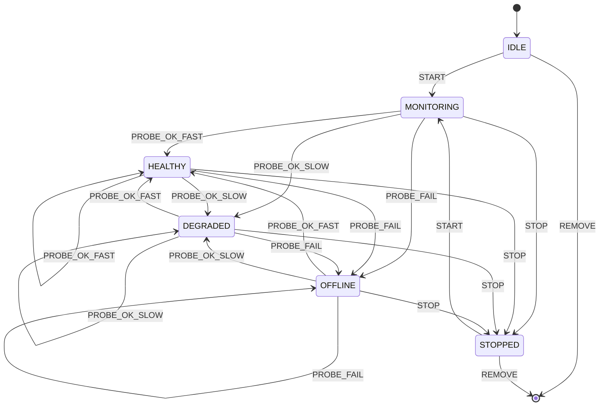

# Automata Design: Network Packet Loss and Latency Monitor

## States
- **IDLE**: target is configured but monitoring is stopped.
- **MONITORING**: periodic ICMP probes are running.
- **HEALTHY**: latest probe succeeded and measured latency is within threshold.
- **DEGRADED**: probe succeeded but latency exceeds threshold, or packet loss is detected.
- **OFFLINE**: probe timed out / failed.
- **STOPPED**: monitoring has been stopped by the user.

## Inputs / Events
`START`, `PROBE_OK_FAST`, `PROBE_OK_SLOW`, `PROBE_FAIL`, `STOP`, `REMOVE`, `RESET`.

## State transition diagram

## Transition table

| Current state | Input / condition | Next state | Action |
|---|---|---|---|
| IDLE | START | MONITORING | Begin periodic ping |
| STOPPED | START | MONITORING | Resume periodic ping |
| MONITORING | Probe succeeds, latency ≤ 100 ms | HEALTHY | Save latency; increment received |
| MONITORING | Probe succeeds, latency > 100 ms | DEGRADED | Save latency; flag high latency |
| MONITORING | Probe fails / timeout | OFFLINE | Save failed probe; increment lost |
| HEALTHY | Probe succeeds, latency ≤ 100 ms | HEALTHY | Update metrics |
| HEALTHY | Probe succeeds, latency > 100 ms | DEGRADED | Raise latency warning |
| HEALTHY | Probe fails | OFFLINE | Mark target unreachable |
| DEGRADED | Probe succeeds, latency ≤ 100 ms | HEALTHY | Clear latency warning |
| DEGRADED | Probe succeeds, latency > 100 ms | DEGRADED | Keep warning |
| DEGRADED | Probe fails | OFFLINE | Mark target unreachable |
| OFFLINE | Probe succeeds, latency ≤ 100 ms | HEALTHY | Mark target reachable |
| OFFLINE | Probe succeeds, latency > 100 ms | DEGRADED | Mark reachable with warning |
| OFFLINE | Probe fails | OFFLINE | Keep offline |
| MONITORING / HEALTHY / DEGRADED / OFFLINE | STOP | STOPPED | Clear probe timer |
| Any configured state | REMOVE | Deleted | Remove target and history |

**Deterministic rule:** one probe result is processed at a time. `latencyThresholdMs` defaults to 100 ms. A successful probe at or below the threshold maps to `HEALTHY`; a successful probe above it maps to `DEGRADED`; a failed probe maps to `OFFLINE`.
